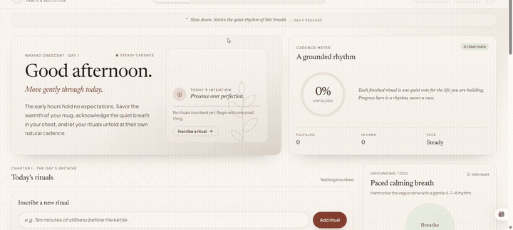
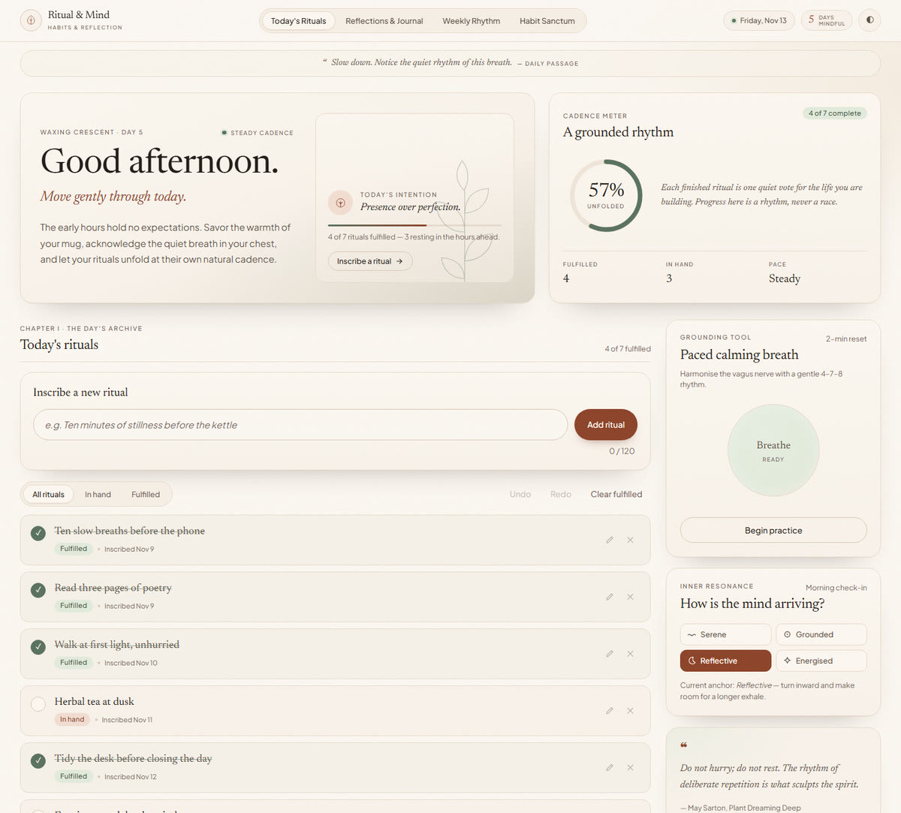
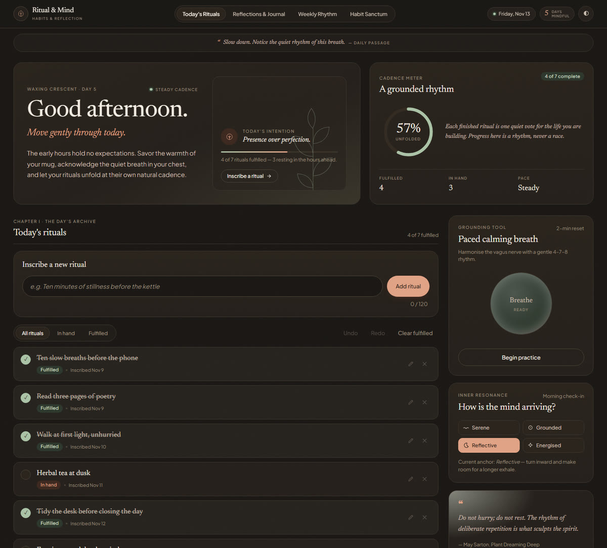
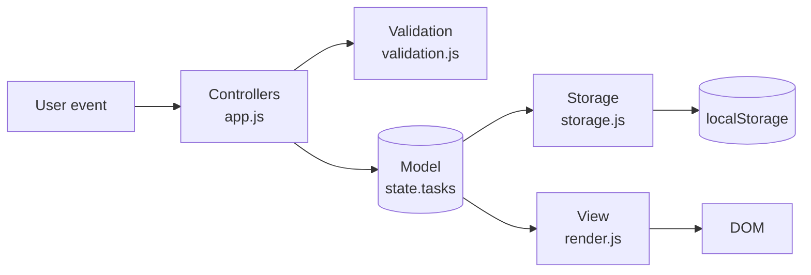
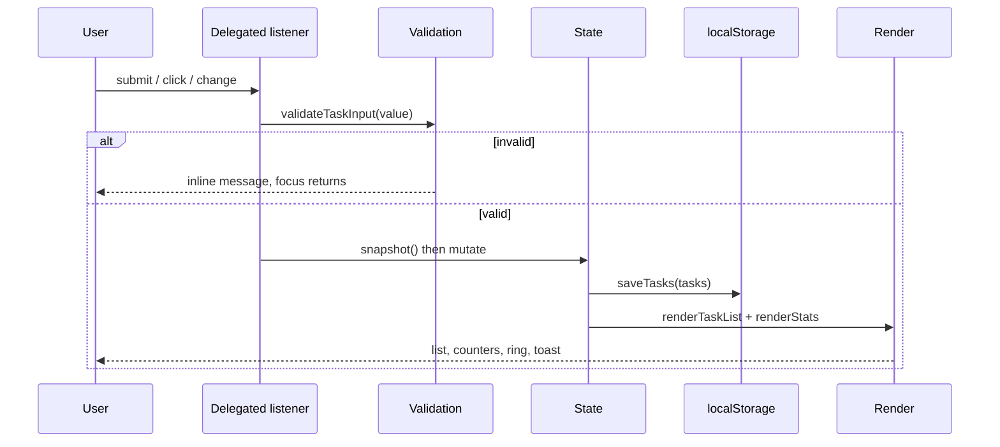

# Ritual & Mind — TaskFlow Lite

**Your client-side task management solution.**

A fully functional task manager built with vanilla JavaScript — no frameworks, no build
step, no backend. Tasks live in `localStorage`, every control works, and the interface is
dressed in a warm "ritual" design language: paper, terracotta and sage, Newsreader serif
headings, Plus Jakarta Sans body copy.

[](demo.mp4)

*Click the recording to open the full-quality `demo.mp4`.*

<p align="center">
  
  
  
</p>

---

## Quick start

Double-click `index.html` — the app is built from classic scripts, so it runs straight from
the filesystem with no server, install or build.

```bash
# or serve it locally
cd taskflow-lite
python3 -m http.server 8080     # or: npx serve .
# open http://localhost:8080
```

Data is stored per browser and per origin. Opening the file directly and serving it over
HTTP use separate storage, so pick one way of working and stick with it.

## Screens

| Light | Dark |
|---|---|
|  |  |

## Features

**Task management**

- Create rituals from the composer, a quick-start chip, or the hero call to action
- Read them with completion state, filters (All / In hand / Fulfilled), counters, cadence
  ring, weekly strip, archive and derived statistics
- Update by toggling a checkbox or editing inline (Enter saves, Escape cancels)
- Delete with a confirmation step, or clear all fulfilled rituals at once
- Undo and redo with a 50-step history (`Ctrl/Cmd+Z`, `Ctrl/Cmd+Shift+Z` or `Ctrl+Y`)

**Persistence and validation**

- Tasks, journal, mood and theme are saved to `localStorage`
- Corrupt JSON, blocked storage and missing fields are handled without breaking the app
- Empty submissions, the 120-character limit and duplicates are rejected with inline,
  screen-reader-friendly messages
- Live validation is debounced at 180 ms; submitting validates immediately
- Unique IDs from `Date.now()` with a collision guard for rapid adds

**Interface and accessibility**

- Responsive from 390 px to ultrawide, with a persisted light/dark theme
- Empty states for every filter, with one-click suggestion chips
- Marquee extras that all work: 4·7·8 breathing practice with a live countdown, mind
  check-in, evening journal with autosave, daily passage and a live date/greeting
- Labelled controls, `aria-live` lists and toasts, `aria-pressed` toggles, visible focus,
  skip link, focus kept after toggling, reduced-motion support
- Lighthouse: **100 Accessibility · 100 Best Practices · 100 SEO**

## Keyboard shortcuts

| Keys | Action |
|---|---|
| `Enter` | Add the ritual / save an inline edit |
| `Ctrl/Cmd + Z` | Undo |
| `Ctrl/Cmd + Shift + Z` or `Ctrl + Y` | Redo |
| `Space` | Toggle the focused ritual |
| `Escape` | Cancel an inline edit |
| `Tab` | Move through every control, including icon buttons |

## Project structure

```
taskflow-lite/
├── index.html            # Markup, landmarks and the page shell
├── app.js                # Entry point: state, controllers, journal, ambience
├── modules/
│   ├── storage.js        # localStorage abstraction (tasks, theme, journal, mood)
│   ├── render.js         # DOM rendering: list, stats, weekly strip, archive
│   └── validation.js     # Form validation and escapeHTML
├── styles/
│   ├── main.css          # Design tokens and components
│   └── utilities.css     # Helper classes
├── images/
│   ├── demo.gif          # Screen recording used above
│   ├── preview-light.jpg
│   ├── preview-dark.jpg
│   └── empty-tasks.svg   # Empty-state illustration
├── demo.mp4              # Original recording
└── README.md
```

## Architecture

The app follows a small MVC-like split. `app.js` owns the model and the controllers,
`modules/render.js` is a pure view that receives data and writes DOM, and
`modules/storage.js` is the only file that touches `localStorage`.



**Decisions that shaped it**

- **Classic scripts, not ES modules.** Files load in order and expose small `TaskFlow*`
  namespaces, so the app works from `file://` as well as over HTTP. No bundler involved.
- **One render path.** Every mutation calls `commit()` → `saveTasks()` → `render()`, so the
  list, counters, ring, week strip, archive and hero meter can never disagree.
- **Efficient DOM writes.** Each render builds a `DocumentFragment` and swaps it in with one
  `replaceChildren()` call.
- **Event delegation.** A single `click`, `change`, `submit` and `keydown` listener on the
  list handles every ritual, including ones added later.
- **Snapshot history.** Undo pushes a JSON snapshot onto a capped stack; redo moves it back.
  A new edit clears the redo branch, exactly like an editor.
- **XSS safety.** Ritual text is inserted with `textContent`, never parsed as HTML.
  `escapeHTML` is available as defence in depth for any future string-building path.
- **Derived, not stored.** Percentages, week dots, archive rows and day counts are computed
  from the task list, keeping a single source of truth.

## Data model

```js
{
  id: 1700000000000,          // unique, Date.now() with collision guard
  text: "Learn JavaScript",   // trimmed, 1–120 characters
  completed: false,
  createdAt: "2024-10-24T07:15:00.000Z"
}
```

### localStorage schema

| Key       | Value |
|-----------|-------|
| `tasks`   | JSON array of task objects (`[]` when absent or corrupt) |
| `theme`   | `"light"` or `"dark"` |
| `journal` | Plain-text evening reflection |
| `mood`    | `"serene"`, `"grounded"`, `"reflective"` or `"energised"` |

Records without `createdAt` load fine and are shown as inscribed today. Invalid records are
dropped during load rather than crashing the render.

## Event flow



## Spec coverage

| Requirement | Where it lives |
|---|---|
| SPA with MVC-like split | `index.html` + `app.js` (model/controllers) + `modules/render.js` (view) |
| Create / Read / Update / Delete | `addRitual`, `renderTaskList`, checkbox toggle, inline edit, delete with confirm |
| localStorage persistence | `modules/storage.js`; every mutation goes through `commit()` → `saveTasks()` |
| JSON serialisation and recovery | `loadTasks()` filters invalid records and falls back to `[]` |
| Efficient DOM updates | `DocumentFragment` + a single `replaceChildren()` per render |
| Event delegation | Click/change/submit/keydown listeners bound once to `#task-list` |
| Validation and feedback | `modules/validation.js`, inline `role="alert"`, debounced live checks |
| Undo and redo | Capped snapshot stacks with toolbar buttons and keyboard shortcuts |
| Empty state and counters | Per-filter empty states, suggestion chips, cadence ring, four stat tiles |
| Light/dark and responsive | `data-theme` tokens in `styles/main.css`, fluid grid down to 390 px |
| Accessibility | Landmarks, labelled controls, `aria-live`, `aria-pressed`, visible focus, skip link |
| Docs and deployment | This file: architecture, schema, event flow, tests, Netlify/GitHub Pages |

## Testing

Functional checklist:

1. Open `index.html` directly and confirm the app runs without a server.
2. Add 50+ rituals, toggle, edit and delete; reload and confirm everything persists.
3. Try an empty ritual, 121 characters and a duplicate; each shows an inline message.
4. Toggle filters; each has its own empty state and suggestion chips where appropriate.
5. Delete a ritual, press **Undo**, then **Redo**; repeat with the keyboard shortcuts.
6. Add a new ritual and confirm **Redo** becomes disabled again.
7. Write a journal note, use **Save note** then **Clear**, reload and confirm both behave.
8. Choose a mood, start **Begin practice** (Inhale → Hold → Exhale), pause, reload.
9. Toggle the theme, reload, and confirm it is remembered. Check reduced motion.
10. Navigate with the keyboard only and run Lighthouse accessibility.

Performance check in the browser console:

```js
const list = document.createElement('ul');
const batch = Array.from({ length: 100 }, (_, i) => ({
  id: i + 1, text: `Ritual ${i + 1}`, completed: i % 2 === 0,
  createdAt: new Date().toISOString(),
}));
TaskFlowRender.renderTaskList(list, batch, { filter: 'all' });
TaskFlowRender.lastRenderMs; // ~6–8 ms for 100 rituals on a laptop, one DOM write
```

`renderTaskList` measures itself into `TaskFlowRender.lastRenderMs`, so the number comes
from the real render path rather than a synthetic benchmark.

## Deploy

Static files only — no build step, no environment variables.

**Netlify (drag and drop):** open [app.netlify.com/drop](https://app.netlify.com/drop) and
drop the `taskflow-lite` folder. Netlify serves `index.html` from the site root.

**GitHub Pages:**

```bash
git init && git add . && git commit -m "TaskFlow Lite"
git branch -M main
git remote add origin https://github.com/<user>/taskflow-lite.git
git push -u origin main
```

Then in the repository: *Settings → Pages → Source: Deploy from a branch → `main` / root*.
The app is live at `https://<user>.github.io/taskflow-lite/`.

Because all scripts are classic scripts, the deployed site and a local `file://` open
behave the same way.

## Decisions and trade-offs

- Validation returns `{ valid, message, value }` rather than a boolean so the UI can show
  specific feedback.
- Inline editing is implemented even though the brief lists it as optional, and undo/redo is
  included as an advanced enhancement.
- Live validation is debounced at 180 ms; submissions are validated immediately and cancel
  any pending check.
- Virtual scrolling was considered and deliberately left out: a personal ritual list stays
  in the hundreds, and one fragment swap already renders 100 rows in well under a frame
  budget. It would add scroll bookkeeping for no measurable gain at this scale.
- Tasks are presented as "rituals" to match the design language; the data model and storage
  keys remain compatible with the original TaskFlow Lite brief.
- `escapeHTML` exists in `validation.js` as defence in depth, but the renderer never builds
  user-facing HTML strings — ritual text is always written with `textContent`.

## Browser support

Chrome, Edge, Firefox and Safari (current versions). The app uses `color-mix()`,
`replaceChildren()` and `matchMedia()`; older browsers degrade gracefully but are not
targeted. No network requests are required at runtime — fonts load from Google Fonts when
online and fall back to local system fonts offline.

## Credits

- Design and code: built for the TaskFlow Lite project.
- Typefaces: [Newsreader](https://fonts.google.com/specimen/Newsreader) and
  [Plus Jakarta Sans](https://fonts.google.com/specimen/Plus+Jakarta+Sans) via Google Fonts.
- Illustration: hand-built inline SVG.

---

*Runs entirely in your browser — no accounts, no tracking, no server.*
